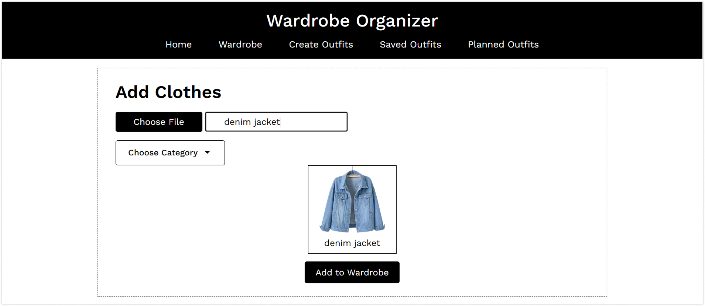
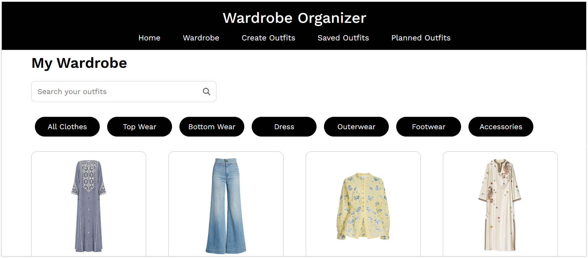
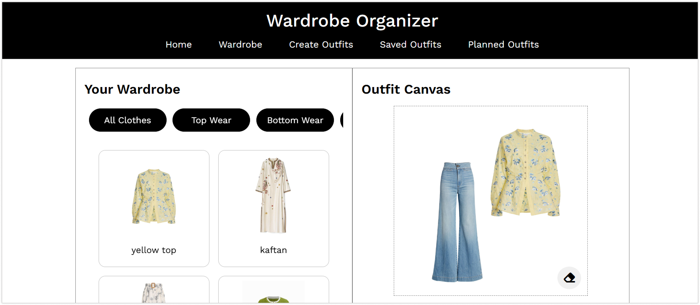
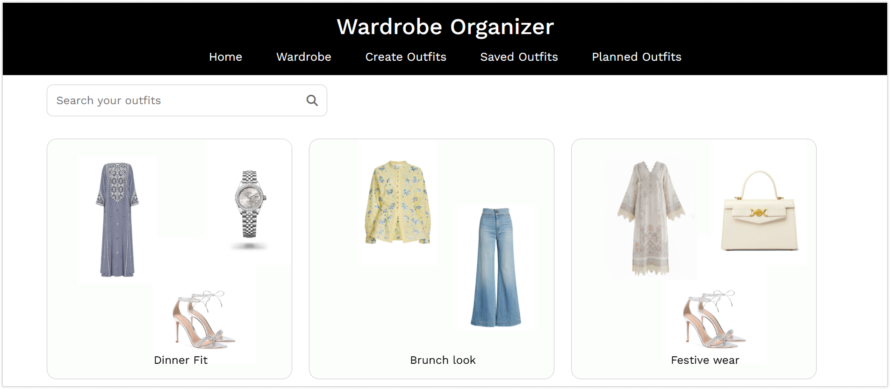
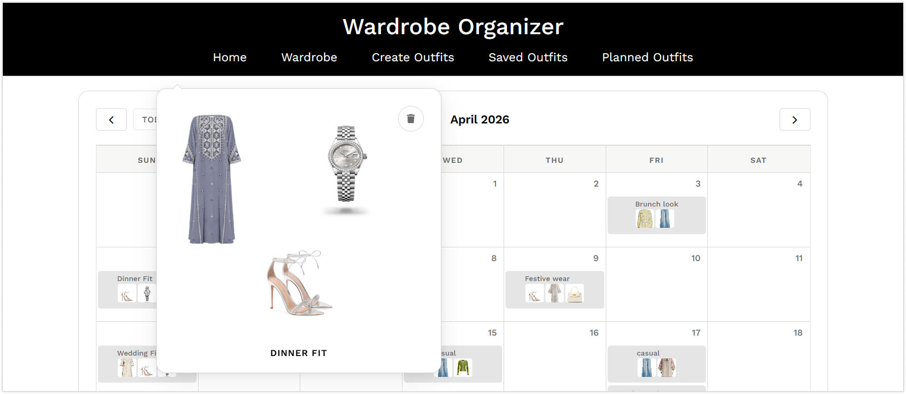

  
   
  ❝ A smarter way to organize what you wear. ❞

 

## Project Overview

- Built with Vanilla JavaScript to implement DOM manipulation, state management and browser storage  
- Handles complex UI interactions and dynamic state without frameworks  
- Persists data client-side using LocalStorage across sessions  
- Optimized for desktop; drag-and-drop and storage behavior may vary on mobile  

## Features

- **Wardrobe Management:** Add, edit, and delete clothing items with names and categories. Filter and search to browse your wardrobe quickly.

- **Outfit Creation:** Create outfits using a visual canvas. Add items with a click and arrange them freely using drag-and-drop.

- **Outfit Planning:** Assign outfits to specific dates via a full calendar view with thumbnails, detailed previews and easy deletion.

- **Saved Outfits Management:** Store created outfits, assign them to dates or delete them when no longer needed.

- **Persistent Storage:** All data is stored in LocalStorage, allowing wardrobe and outfits to persist across sessions.

## Screenshots

| | |
|:---:|:---:|
| Wardrobe | Create Outfits |
|  |  |
| Saved Outfits | Planned Outfits |
|  |  |

## Built With

| Technology | Usage |
|---|---|
| HTML5 | Structure & layout |
| CSS3 | Responsive styling |
| Vanilla JavaScript | All interactivity & logic |
| LocalStorage API | Data persistence |
| FullCalendar | Calendar interface |

## Installation

> [!NOTE]  
> If you prefer not to install it locally, you can also access the [live demo](https://wardrobeorganizer.vercel.app)

To set up the Wardrobe Organizer Application locally, follow these steps:

1. Clone the repository with `git clone https://github.com/imanabshar/wardrobe-organizer.git`.
2. Navigate to where the repository is saved on your local machine and open up its `index.html`.

